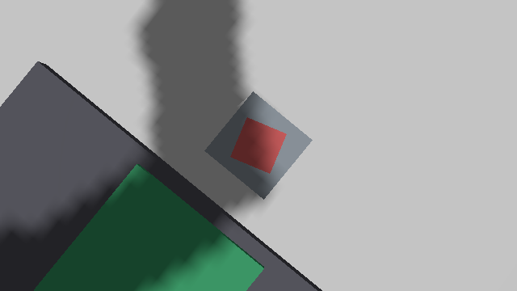
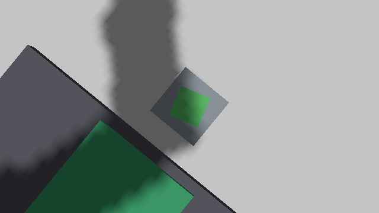
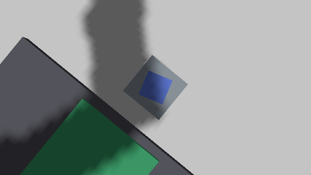

# Entrega 3: Visión, nodo de estación e integración · Estación 2

**TRÍADA · clasificación por visión · configuración RRP (SCARA)**
Universidad EIA · Robótica y Control Digital · octubre de 2026

---

## 1. Piezas de colores

`station2_description/launch/simulacion.launch.py` crea tres piezas de prueba
del mismo tamaño que la pieza de la línea (20 × 20 × 12 mm, 20 g), una por
categoría:

| modelo | color | categoría |
|---|---|---|
| `pieza_roja` | rojo | A |
| `pieza_verde` | verde | B |
| `pieza_azul` | azul | C |

Quedan aparcadas en y = −0.30 m, fuera del área de trabajo, y la prueba las
lleva al traspaso 1-2 una a una. Cada pieza tiene su propio `DetachableJoint`
hacia `link_3` (temas `/station2/<pieza>/attach` y `/detach`), igual que hace
la Estación 1 con su pieza.

## 2. Cámara y nodo de visión

- **Cámara**: Camera Module 3 Wide (102° de campo horizontal), bajo el eslabón
  2, mirando hacia abajo. En Gazebo, sensor `camera` a 640 × 360 y 5 Hz en
  `/station2/camara/image`.
- **Nodo** `ros2 run station2_control vision`, servicio
  `/station2/clasificar` (`std_srvs/Trigger`), que responde con la categoría.

Método, deliberadamente simple y explicable:

1. Región central de la imagen (cuadrado del 40 % de la altura).
2. Paso a HSV; se descartan los píxeles poco saturados (S < 0.45: soporte,
   mesa) y los oscuros (V < 0.20: sombras).
3. Reparto por tono: rojo 340°–20°, verde 80°–160°, azul 200°–260°.
4. Gana el color con más píxeles si supera 40; si no, `success = false`.

No usa OpenCV ni cv_bridge: la imagen `rgb8` se decodifica con numpy. Cada
clasificación guarda la imagen como evidencia (parámetro `carpeta_evidencia`).

| | | |
|---|---|---|
|  |  |  |
| A | B | C |

## 3. Nodo de estación y contrato

`ros2 run station2_control nodo_estacion`, que habla el contrato de la línea
(ADR-004):

| interfaz | tipo | uso |
|---|---|---|
| `/line/station2/start` | servicio `StartTask` | entrada; rechaza si está ocupada |
| `/line/station2/done` | tema `HandoffEvent` | una vez por ciclo, con la categoría y la pose de entrega |
| `/line/station2/state` | tema `StationState` | latido a 2 Hz (IDLE, BUSY, DONE, ERROR) |

Ciclo:

1. traspaso 1-2, codo arriba: aproximar, bajar, cerrar, acoplar, subir;
2. puesto de inspección: bajar, soltar, subir;
3. cámara sobre la pieza, `/station2/clasificar` → categoría;
4. puesto de inspección: bajar, cerrar, acoplar, subir;
5. traspaso 2-3, codo abajo: bajar, desacoplar, abrir, subir;
6. reposo y `done` con la categoría.

Las aproximaciones son verticales (solo se mueve la prismática), de modo que la
pieza no se arrastra de lado. Tiempo de ciclo medido: unos 26 s, dentro del
plazo de 60 s del orquestador.

## 4. Precisión (< 20 mm)

`ros2 run station2_control prueba_estacion`: coloca cada pieza en el traspaso
1-2, pide un ciclo por el contrato, espera `done` y lee de Gazebo dónde quedó la
pieza.

| pieza | esperada | asignada | ciclo | posición final (m) | error en planta | error en altura |
|---|---|---|---|---|---|---|
| roja | A | A | 25.9 s | (0.720000, 0.000000, 0.048000) | 0.000 mm | 0.000 mm |
| verde | B | B | 25.6 s | (0.720000, 0.000000, 0.048000) | 0.000 mm | 0.000 mm |
| azul | C | C | 25.8 s | (0.720000, −0.000000, 0.048000) | 0.000 mm | 0.000 mm |

Clasificación correcta 3 de 3; error de posicionamiento por debajo de la
resolución de Gazebo (1 µm). Hay que leer esta cifra con honestidad: en la
simulación las articulaciones se mandan en posición y el acople es rígido, así
que el error es prácticamente nulo. En la máquina real la precisión la fijarán
el juego de las correas, la resolución de los encoders y el centrado de la
mordaza; el margen hasta los 20 mm es amplio.

## 5. Prueba con el orquestador

Estación 2 completa en Gazebo (control, visión y entrega) y Estaciones 1 y 3
como nodos de prueba del paquete `line_orchestrator`. Como el mock de la
Estación 1 no mueve ninguna pieza, `alimentador_linea` hace su parte: cuando la
Estación 1 pasa a BUSY, coloca la siguiente pieza de color en el traspaso 1-2.

```
ros2 launch station2_description simulacion.launch.py gui:=false
ros2 run station2_control vision
ros2 run station2_control nodo_estacion
ros2 run station2_control alimentador_linea
ros2 launch line_bringup line.launch.py mock_stations:=station1,station3
```

| pieza | categoría | tiempo de línea |
|---|---|---|
| 1 | A | 32.7 s |
| 2 | B | 31.9 s |
| 3 | C | 32.1 s |

"corrida terminada: 3 piezas, tiempo medio de línea 32.2 s". Registro en
`prueba_linea_orquestador.md`.

## 6. Línea completa

Con las tres estaciones reales en el mismo Gazebo y el orquestador sin nodos de
prueba, la línea completó una pieza de punta a punta: la Estación 1 la llevó al
traspaso 1-2, la Estación 2 la clasificó como A (error de tool0 de 0.12 mm) y
la dejó en el 2-3 a 0.029 mm del punto, y la Estación 3 la contó en la caja A.
Detalle y observaciones para el equipo (Gazebo al 17 % del tiempo real en la
nube, tolerancias con carga y la pieza propia de la Estación 3) en
`prueba_linea_completa.md`.

## 7. Arquitectura

```
      orquestador ── start/done/state ──► nodo_estacion ──► brazo_controller ─┐
                                              │   ▲         mordaza_controller ├─ gz_ros2_control
                                              │   └ TF tool0                   │
                                 /station2/clasificar                          │
                                              ▼                               ▼
                                           vision ◄── /station2/camara/image ── Gazebo
                                              
      attach / detach  ──► DetachableJoint (pieza ↔ link_3)
```
